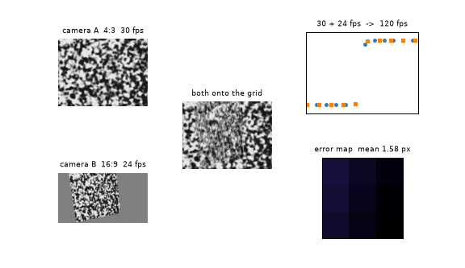
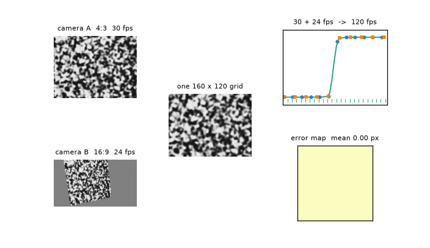
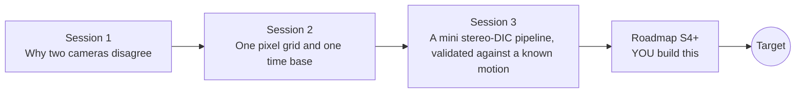

# openstitchdic

[](https://github.com/KrunalPanchal1995/openstitchdic/actions/workflows/ci.yml)   [](https://colab.research.google.com/github/KrunalPanchal1995/openstitchdic/blob/main/sessions/session-01/lesson.ipynb) [](https://krunalpanchal1995.github.io/openstitchdic/)

**Put two mismatched cameras on one pixel grid and one clock, then measure how well it worked.**

openstitchdic teaches how to merge two cameras with different angles, frame rates and picture shapes into one clean data set for digital image correlation, using homographies and Makima interpolation written from scratch in numpy.

- **Start from zero.** Session 1 needs only a cosine and a clock; homographies and interpolation are built up step by step.
- **Write the maths yourself.** Homography, bilinear warping, Akima, Makima and cubic spline are all implemented in plain numpy, with no scipy.
- **Drop your images here.** Put view_a.png and view_b.png in a folder named data and Session 3 aligns your own pair; otherwise it makes synthetic speckle pictures.
- **Know you got it right.** Each session ends with a checkpoint that prints PASS or FAIL against hand calculations and a known true motion.

[Target](#the-target) · [Who is this for](#who-is-this-for) · [Quick start](#quick-start) · [Sessions](#sessions) · [Roadmap](#roadmap) · [Contribute](#contribute) · [Explainer PDF](docs/explainer.pdf)

> **This repo is incomplete on purpose.** Sessions 1 to 3 are here and fully working. The finished Target below is a preview of what the community can build next. We show you the path, not the code. Sessions 4 and up are yours.

## The Target

Two raw pictures of one speckled sample, one 4:3 and head-on, one 16:9 and skewed, flow into a single 160 x 120 grid where their ghosting disappears. At the same time the 30 fps and 24 fps sample ticks of a step-like motion drop onto one 120 fps timeline, and the error map shrinks to zero. Your goal over the coming sessions: build that pipeline for your own two cameras.



*Target: two mismatched cameras flow into one grid and one timeline while the error map shrinks*



*Target, last frame: one 160 x 120 grid, a common 120 fps timeline, zero error map*

Try it live:

- [Math Visual Studio: matrices as transformations (Atlas S20)](https://krunalpanchal1995.github.io/studio/#atlas?ch=S20&ex=1)
- [Math Visual Studio: sub-pixel edges (Atlas S115)](https://krunalpanchal1995.github.io/studio/#atlas?ch=S115&ex=1)

How the Target was made is shown only as a path in [promo/roadmap.md](promo/roadmap.md).

## Who is this for
**higher secondary to advanced undergraduate (levels 4-6).** Topic area: Statistics, Research and Experimental Methods.

Prerequisites:

- Cosine of an angle and a straight-line graph (school level); matrices help in Session 2 but are explained there.
- Python 3.10 or newer; if `python --version` works, you are ready. PRIMER.md explains the rest.
- No prior GitHub, image-processing or DIC experience is needed.

New to Python? Read [PRIMER.md](PRIMER.md) first (10 minutes).

## Quick start

No installation knowledge needed. You need [Git](https://git-scm.com/downloads) and [Python 3.10+](https://www.python.org/downloads/) (Windows: tick "Add Python to PATH"). On Mac and Linux type `python3` wherever this page says `python`.

```bash
git clone https://github.com/KrunalPanchal1995/openstitchdic.git
cd openstitchdic
python start.py 1
```

`start.py` creates a private environment, installs what is needed and runs Session 1 with its checkpoint. Next: `python start.py 2`, `python start.py 3`, or `python start.py test` to check everything. Only a checkpoint: `python start.py check 1`.

Four lines turn the idea of Session 1 into numbers (they work as they are): Save it as `try.py` and run it with `python start.py run try.py` (this uses the private environment, where NumPy is installed):

```python
import numpy as np
yaw = np.radians(40)                         # camera B looks 40 degrees to the side
print(round(100 * np.cos(yaw), 1))           # -> 76.6   a 100 px sideways distance looks this wide
print(round(1000 / 60, 1))                   # -> 16.7   ms: worst gap between 30 fps and 24 fps pictures
```

Every session also opens in your browser with sliders (no install): [live apps](https://krunalpanchal1995.github.io/openstitchdic/). Or use the Colab badge above for the notebook.

## Sessions

| # | Session | Model level | Time | Live app |
|---|---|---|---|---|
| 1 | [Why two cameras disagree](sessions/session-01/README.md) | Level 1: conceptual interactive model | 60 min | [open](https://krunalpanchal1995.github.io/openstitchdic/session-01/) |
| 2 | [One pixel grid and one time base](sessions/session-02/README.md) | Level 2: mathematical engineering model | 80 min | [open](https://krunalpanchal1995.github.io/openstitchdic/session-02/) |
| 3 | [A mini stereo-DIC pipeline, validated against a known motion](sessions/session-03/README.md) | Level 3: simulation and validation | 90 min | [open](https://krunalpanchal1995.github.io/openstitchdic/session-03/) |

Each session follows the same six steps: A real-world problem, B concept and theory, C visual explanation, D interactive simulation, E worked example and experiment, F assessment and design challenge. Each ends with `checkpoint.py`, which prints `PASS` or `FAIL` against reference numbers. Session 3 also contains the real-world mini-project: **Align a 30 fps 4:3 camera and a 24 fps 16:9 camera, and report the error before and after**.

## Architecture



| Folder or file | What is inside |
|---|---|
| `sessions/` | three sessions: README (A-F), `lesson.py`, notebook, live app, exercises, activity sheet, checkpoint |
| `promo/` | the Target: media, live links, and the roadmap (path only) |
| `docs/` | `explainer.tex` and the built `explainer.pdf` |
| `tests/` | runs every lesson and checkpoint headless |
| `start.py` | one command to set up and run anything |
| `QUALITY.md`, `RUBRIC.md` | the quality checklist and the scoring rubric |
| `.github/` | CI, PDF build, Pages deploy, issue and PR templates |

## Roadmap

| Milestone | What you will build | Difficulty |
|---|---|---|
| Session 4: Lens distortion | A distortion model (one radial term) fitted from the sheet corners and edge points, applied before warping. | intermediate |
| Session 5: Calibration targets and 3-D triangulation | A calibration routine plus triangulation of matched points into millimetres. | advanced |
| Session 6: Rolling-shutter correction | A simulator with a row-by-row readout and a correction that resamples each row in time. | advanced |
| Session 7: Correlation at GPU speed | A batched correlator that handles a 100 x 100 grid of subsets per frame pair. | advanced |
| Session 8: Your own cameras | A run of Session 3 on your own two videos, with points.txt, an estimated offset and a written error budget. | intermediate |

Full detail with a checkpoint per milestone: [promo/roadmap.md](promo/roadmap.md).

## Contribute
New to GitHub? Read [CONTRIBUTING.md](CONTRIBUTING.md); it starts from zero. Pick an issue labelled `good first issue`. Translations into Hindi, Telugu, Tamil and Malayalam are welcome.

<details>
<summary>Development</summary>

```bash
python start.py test        # runs every lesson and checkpoint
```
Lessons use `# %%` cell markers so they open as notebooks in VS Code. See [QUALITY.md](QUALITY.md) for the standard every session meets.
</details>

## License
MIT. See [LICENSE](LICENSE). Media in `promo/media` is (c) Krunal Panchal, CC BY 4.0.

## Acknowledgments
Part of the [PAN IIT OSS](https://hellofoss.tech-iitb.org/projects) open-source teaching collection, modelled on the structure of [openspline](https://github.com/openspline/openspline). Built on ideas from the Math Visual Studio at https://krunalpanchal1995.github.io/studio/.
