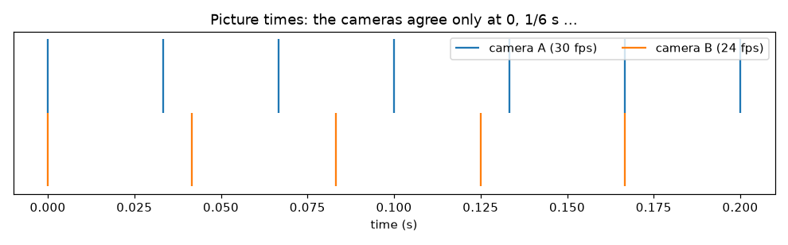
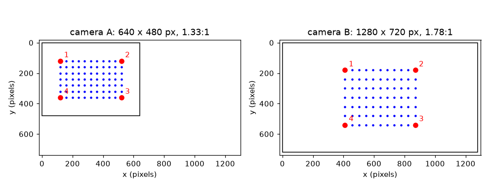

# Session 1: Why two cameras disagree

*Level 1 (conceptual interactive model) · about 60 minutes · openstitchdic*

> This is a simplified educational model. It is not a validated design tool and must not be used for real structures, electrical installations, vehicles, industrial processes or medical decisions.

**Prerequisites**

- School trigonometry: the cosine of an angle.
- You have read PRIMER.md and run `python start.py 1` once.

**Learning objectives.** After this session you can:

- Explain three ways two cameras can disagree: viewpoint, picture size and shape, and timing.
- Compute how much a sideways distance is squeezed when a camera is turned by an angle.
- Match landmarks between two pictures and find the stretch that brings one onto the other.
- Compute when two frame rates agree and how big the timing gap is in between.

## A. Real-world problem
You film a speckled rubber sheet with two cameras to measure how it deforms (this is stereo digital image correlation, DIC). Camera A looks straight at the sheet. Camera B stands to one side, has a wider picture and runs at 24 pictures a second while A runs at 30. If you do not adjust anything, nothing lines up: the grid on the sheet looks different from the two angles, the pictures have different sizes, and the moment of each picture is different. How big are these differences, and can one simple fix remove them? (This is general education about a measurement method, not a validated measurement procedure.)

## B. Concept and theory
Three differences. (1) Viewpoint: a camera turned by an angle yaw to the side sees sideways distances on a flat sheet squeezed by cos(yaw), while up-and-down distances stay the same. This is the simplest model, valid for a far-away camera; Session 2 adds full perspective. (2) Picture size and shape: camera A is 640 x 480 pixels (4:3) and camera B is 1280 x 720 (16:9), and each has its own number of pixels per unit of the sheet. The stretch that brings B onto A is found from landmarks: divide the distance between two landmarks in A by the same distance in B, once sideways and once up-down. If the two numbers differ, one resize factor cannot fix it. (3) Timing: A takes pictures at k/30 s and B at m/24 s. They agree only when k/30 = m/24, which happens every 1/gcd(30, 24) = 1/6 s. In between, the nearest B picture is up to 1/60 s away, and a moving sample travels speed times gap in that time.

| Symbol | Meaning | Unit |
|---|---|---|
| yaw | angle by which a camera is turned to the side | degrees |
| cos(yaw) | sideways squeeze factor | no unit |
| k | pixels per unit of the sheet (picture scale) | pixels per unit |
| sx, sy | stretch from picture B onto picture A, sideways and up-down | no unit |
| fps | pictures per second of a camera | 1/s |
| gap | time from an A picture to the nearest B picture | s |
| v | speed of the sample in the picture | pixels per second |

**Assumptions**

- The sheet is flat and the cameras are far away, so a turned camera only squeezes sideways distances.
- Both clocks start together at t = 0 and run steadily.
- Frame rates are whole numbers.

$$ x_{\mathrm{pix}}=c_x+k\cos(\mathrm{yaw})\,x,\qquad y_{\mathrm{pix}}=c_y+k\,y $$

$$ s_x=\frac{x_{A,2}-x_{A,1}}{x_{B,2}-x_{B,1}}=\frac{k_A}{k_B\cos(\mathrm{yaw}_B)},\qquad s_y=\frac{k_A}{k_B} $$

$$ T_{\mathrm{agree}}=\frac{1}{\gcd(f_A,\,f_B)} $$

$$ \Delta x = v\cdot \mathrm{gap} $$

## C. Visual explanation
The first figure draws the same 11 x 7 grid of dots as seen by the two cameras, with each picture drawn to the same pixel scale: A is a 4:3 frame with a square-looking grid, B is a wider 16:9 frame in which the grid looks narrower because the camera is turned 40 degrees. Four red landmarks (the sheet corners) are numbered in both pictures so you can match them by eye. The second figure puts the picture times of both cameras on one time axis: the 30 fps ticks and 24 fps ticks meet at 0 and at 1/6 s and in between the nearest ticks are up to 16.7 ms apart.

*Picture times of the two cameras: they agree only every 1/6 s.*

*The same grid as seen by the two cameras: different picture shape, size and squeeze.*

## D. Interactive simulation
Run the lesson (`python start.py 1`), then open the live app: [Session 1: two views and two clocks](https://krunalpanchal1995.github.io/openstitchdic/session-01/) (or `app.html` in this folder). Turn camera B with the yaw slider and watch its grid get narrower, then open the timing view, change B's frame rate and watch the distance to the nearest B picture. The readout tells you how far a sample at the chosen speed moves during the worst gap.

**Challenge.** Keep the squeeze at 0.8 or better (yaw 36 degrees or less) and make the worst timing error less than 1 px for a sample moving at 120 px/s.

## E. Worked example and experiment
**Problem.** Camera B is turned 40 degrees. A square on the sheet is 100 pixels wide in camera A (looking straight on). How wide does it look sideways in a picture taken at the same scale by B? And how far does a sample moving at 120 px/s travel in the worst timing gap between a 30 fps and a 24 fps camera?

1. Squeeze = cos 40 = 0.766.
2. Width in B at the same scale = 100 * 0.766 = 76.6 pixels.
3. Cameras agree every 1/gcd(30, 24) = 1/6 s. Within one cycle the A pictures are at 0, 1/30, 2/30, 3/30, 4/30 s and the B pictures at 0, 1/24, 2/24, 3/24 s.
4. The nearest-B distances for the five A pictures are 0, 8.33, 16.67, 16.67 and 8.33 ms. The worst gap is 16.7 ms = 1/60 s.
5. Distance moved = 120 px/s * (1/60) s = 2.0 px.

**Answer.** The square looks 76.6 pixels wide, and the worst timing gap of 16.7 ms moves a 120 px/s sample by 2.0 px, which is a large error in a measurement that aims at hundredths of a pixel.

**Experiment.** Draw a 10 x 6 grid on a sheet of paper, photograph it head-on and again from the side with a phone, and measure the grid widths in the two photos with an image viewer. The ratio of widths should be close to the cosine of your viewing angle. Differences come from perspective (the near edge is bigger than the far edge), lens distortion and a badly measured angle: the model squeezes uniformly, a real camera does not.

## F. Assessment and design challenge
**Question type A: Conceptual.** Why can one resize factor not bring camera B's picture onto camera A's picture in this set-up?

Hint

Compute the sideways and the up-down stretch from the sheet corners and compare them.

Step-by-step solution

The sideways stretch is 40 / (60 cos 40) = 0.870 and the up-down stretch is 40 / 60 = 0.667. They differ because B is turned (its sideways distances are squeezed by cos 40) and the pictures have different scales. A single resize factor can only apply one number, so a transform with different sideways and up-down parts (and, in general, perspective, which is Session 2) is needed.

**Question type B: Numerical.** A camera is turned 60 degrees to the side. A sideways distance is 100 pixels in a head-on picture. How long does it look? A sample at 90 px/s is paired with a picture 1/60 s away: how far has it moved?

Hint

Use squeeze = cos(yaw) and distance = speed * gap.

Step-by-step solution

cos 60 = 0.5, so the distance looks 100 * 0.5 = 50 pixels (units: pixels). The sample moves 90 * (1/60) = 1.5 px. Sanity check: at 90 degrees the squeeze would be 0, the sheet seen edge-on, which is why very large angles are useless.

**Question type C: Graph and simulation interpretation.** In the timing graph (frame rate of B = 24), what is the highest the curve reaches, and what do the red dots tell you?

Hint

The curve is the distance to the nearest B picture; the dots are read at the A picture times.

Step-by-step solution

The curve reaches half a B period, 1/48 s = 20.8 ms, in the middle between two B pictures. The red dots at the A picture times read 0, 8.33, 16.67, 16.67 and 8.33 ms over one 1/6 s cycle, so the worst gap seen by any A picture is 16.7 ms, below the curve's peak because A pictures do not fall exactly in the middle of a B interval.

**Question type D: Design and optimisation challenge.** Design: camera A runs at 30 fps. Which of these B frame rates keep the worst gap at or below 10 ms: 24, 25, 30, 48, 50, 60? Which would you choose, and what do you give up?

Hint

Use the timing view or worst_gap(30, fps) in lesson.py.

Step-by-step solution

The worst gaps are 16.7 ms (24), 20 ms (25), 0 (30), 8.3 ms (48), 6.7 ms (50) and 0 (60). So 30, 48, 50 and 60 are within 10 ms. 30 or 60 give exact agreement (gap 0) but only if the two clocks start together; 60 doubles the data and needs more light and storage. Trade-off: a perfectly matched pair removes the need for time interpolation, but you often cannot choose, so Session 2 shows how to interpolate instead.

Score yourself with [RUBRIC.md](../../RUBRIC.md). Print the [activity sheet](activity_sheet.md) to work on paper.

## Common misconceptions
| Common misconception | What is actually true |
|---|---|
| Two cameras at 30 and 24 fps can just be paired frame by frame. | Frame k of A and frame k of B are taken at different times (k/30 s and k/24 s); they agree only every 1/6 s. |
| A turned camera just shrinks the whole picture. | It squeezes sideways distances by cos(yaw) and leaves up-down distances alone, so shapes change, not only size. |
| Picture size and picture shape are the same thing. | Size is the number of pixels; shape is the aspect ratio (4:3 or 16:9). Two cameras can match in one and differ in the other. |

## Glossary
- **digital image correlation (DIC)**: measuring how a surface moves or deforms by following a speckle pattern in pictures
- **yaw**: the angle by which a camera is turned sideways
- **aspect ratio**: width divided by height of a picture, such as 4:3 or 16:9
- **landmark**: a point you can recognise in both pictures, such as a sheet corner
- **frame rate (fps)**: pictures per second

## Finish
1. Do the three coding tasks in [exercises.md](exercises.md).
2. Run `python start.py 1` again after your changes. It ends with the checkpoint; when it prints `PASS`, you are done. (Checkpoint only: `python start.py check 1`.)

Next: [Session 2](../session-02/README.md)
