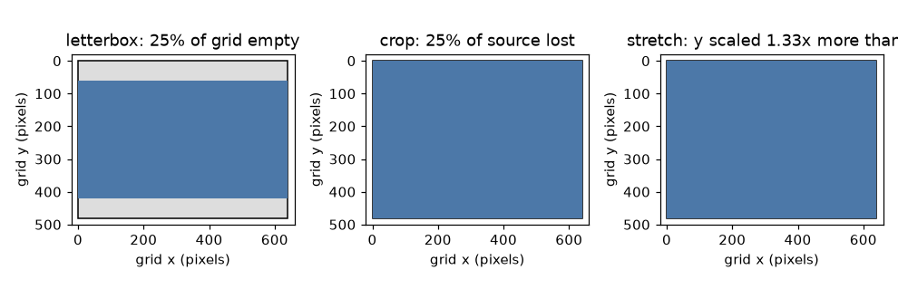
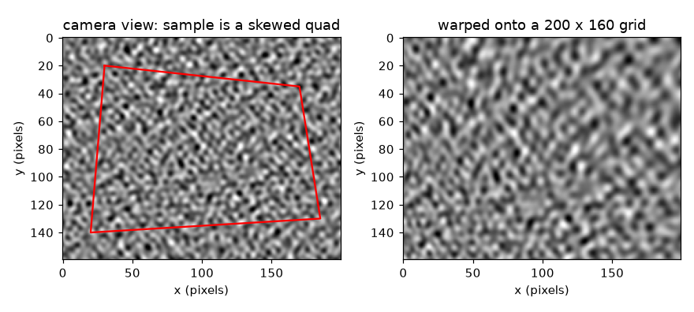
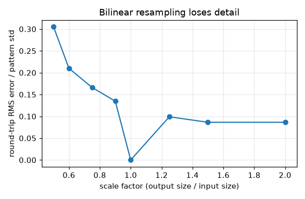
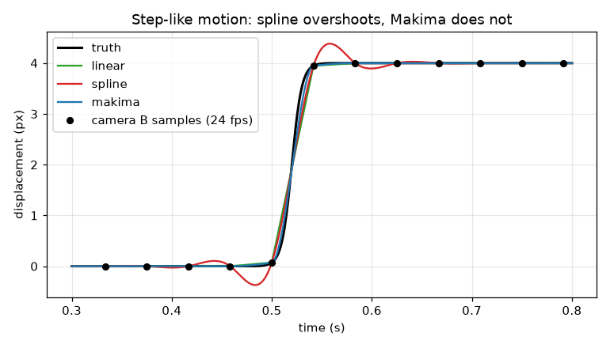

# Session 2: One pixel grid and one time base

*Level 2 (mathematical engineering model) · about 80 minutes · openstitchdic*

> This is a simplified educational model. It is not a validated design tool and must not be used for real structures, electrical installations, vehicles, industrial processes or medical decisions.

**Prerequisites**

- Session 1: squeeze, stretch and frame times.
- Matrices times points and solving a linear system (explained in Section B).

**Learning objectives.** After this session you can:

- Solve a homography from four point pairs and apply it by inverse mapping with bilinear sampling.
- Compare letterbox, crop and stretch when fitting one aspect ratio into another, and compute the cost of each.
- Quantify how resampling blurs a speckle pattern.
- Derive and implement Makima interpolation and compare it with linear and cubic spline on smooth and step-like motion.
- Recover a known timing offset between two cameras by cross-correlation.

## A. Real-world problem
Before any correlation, both cameras must give the same kind of data: the same pixel grid and the same clock. Camera B is 16:9 and sees the sample from the side; the sample is 4:3. Camera A samples the motion every 1/30 s and B every 1/24 s. How do you map B's picture onto a regular grid without wrecking the speckle? How do you fit a 16:9 picture into a 4:3 grid? And how do you put two series with different sample times on one timeline without inventing wiggles at a sudden jump? (A simplified educational model, not a validated measurement procedure.)

## B. Concept and theory
Geometry. A homography maps a flat sheet seen by one camera onto the same sheet seen by another: x' = (h11 x + h12 y + h13) / (h31 x + h32 y + 1), y' = (h21 x + h22 y + h23) / (h31 x + h32 y + 1). Multiplying out the denominator makes each point pair give two linear equations in the eight unknowns h, so four pairs give an 8 x 8 system. To build an output picture we use inverse mapping: for each output pixel find where it came from (H inverse) and read the source there with bilinear interpolation, a weighted average of the four neighbours. Aspect ratio. For a source of aspect r and a grid of aspect t, letterbox and crop both cost 1 - min(r, t) / max(r, t) of the pixels (empty grid pixels, or lost source pixels), while stretch costs nothing in pixels but scales y by max/min relative to x. Resampling. Bilinear sampling at a fractional position f weights two neighbours by (1 - f) and f, so white noise keeps sqrt((1-f)^2 + f^2) of its standard deviation: 0.707 at f = 0.5. Time. Both cameras are put on a 120 fps timeline (120 = 4 x 30 = 5 x 24). Makima builds a cubic Hermite curve through every sample. With segment slopes m_i the slope at a sample is d_i = (w1 m_{i-1} + w2 m_i) / (w1 + w2) with w1 = |m_{i+1} - m_i| + |m_{i+1} + m_i| / 2 and w2 = |m_{i-1} - m_{i-2}| + |m_{i-1} + m_{i-2}| / 2. The original Akima weights lack the second term and become 0/0 where neighbouring slopes agree; at a corner between a flat run and a ramp the fallback slope makes the curve dip below the data. Makima keeps the smaller slope there. It reproduces straight lines exactly, is not exact for quadratics (unlike Akima and the spline), is C1 (slope continuous) but not C2, and is local (a change in one sample reaches only a few intervals away) while the spline is global. Offset. If camera B's clock is late by tau, its picture labelled t shows the motion at t + tau; the lag that maximises the normalised cross-correlation of the two resampled series gives tau, refined by a parabola through the three points around the peak.

| Symbol | Meaning | Unit |
|---|---|---|
| H | 3 x 3 homography matrix (h33 = 1) | no unit |
| (x, y), (x', y') | pixel position before and after the map | pixels |
| f | fractional part of a sampling position | pixels |
| r, t | aspect ratio of the source picture and of the grid | no unit |
| m_i | slope of the straight segment from sample i to i+1 | px/s |
| d_i | Makima slope at sample i | px/s |
| tau | timing offset of camera B | s |

**Assumptions**

- The sample is flat, so one homography describes each camera.
- Pixel centres are at integer coordinates (x = column, y = row).
- Cameras run at whole-number frame rates and clocks are steady; only a fixed offset tau is unknown.
- Displacement series are smooth between samples except at a sudden jump.

$$ x'=\frac{h_{11}x+h_{12}y+h_{13}}{h_{31}x+h_{32}y+1},\qquad y'=\frac{h_{21}x+h_{22}y+h_{23}}{h_{31}x+h_{32}y+1} $$

$$ \begin{pmatrix}x&y&1&0&0&0&-xx'&-yx'\\0&0&0&x&y&1&-xy'&-yy'\end{pmatrix}\mathbf h=\begin{pmatrix}x'\\y'\end{pmatrix} $$

$$ \text{letterbox / crop cost}=1-\frac{\min(r,t)}{\max(r,t)},\qquad \text{stretch ratio}=\frac{\max(r,t)}{\min(r,t)} $$

$$ \frac{\sigma_{\text{after}}}{\sigma_{\text{before}}}=\sqrt{(1-f)^2+f^2} $$

$$ d_i=\frac{w_1m_{i-1}+w_2m_i}{w_1+w_2},\quad w_1=|m_{i+1}-m_i|+\tfrac12|m_{i+1}+m_i|,\quad w_2=|m_{i-1}-m_{i-2}|+\tfrac12|m_{i-1}+m_{i-2}| $$

$$ p(x)=h_{00}(t)y_i+h_{10}(t)\,\Delta x\,d_i+h_{01}(t)y_{i+1}+h_{11}(t)\,\Delta x\,d_{i+1},\qquad t=\frac{x-x_i}{\Delta x} $$

## C. Visual explanation
The first figure shows a speckle picture in which the sample appears as a skewed quadrilateral (red) and the same picture warped by the homography onto a regular 200 x 160 grid. The second shows the three ways to fit a 16:9 picture into a 4:3 grid: letterbox leaves 25 percent of the grid empty, crop throws away 25 percent of the source, stretch keeps everything but scales y by 1.33 relative to x. The third plots the round-trip error of resizing a speckle picture against the scale factor: it grows as the picture is made smaller, reaching about 0.3 of the pattern's standard deviation at half size. The fourth shows a step-like motion sampled at 24 fps and the three interpolants: the cubic spline overshoots the step by about 0.38 px, linear cuts the corner, Makima follows the step without overshoot.

*Letterbox, crop and stretch for a 16:9 picture in a 4:3 grid.*

*A skewed view of the sample (left) and the same picture warped onto a regular grid (right).*

*Round-trip resizing error against scale factor.*

*A step-like motion at 24 fps: spline overshoots, linear cuts the corner, Makima follows.*

## D. Interactive simulation
Run the lesson (`python start.py 2`), then open the live app: [Session 2: aspect-ratio cost and time interpolation](https://krunalpanchal1995.github.io/openstitchdic/session-02/) (or `app.html` in this folder). Change the step width and the frame rate of camera B and watch the linear and Makima curves against the truth. In the aspect view change the width of B's picture and watch the cost of letterbox, crop and stretch.

**Challenge.** Set camera B to 60 fps and choose a picture width that wastes at most 10 percent of the grid when letterboxed; then read the Makima error in the readout.

## E. Worked example and experiment
**Problem.** A homography has H = [[1, 0.2, 10], [0, 1, 5], [0.001, 0, 1]]. Where does the pixel (100, 50) go, and does the inverse bring it back?

1. Compute the denominator: w = 0.001 * 100 + 0 * 50 + 1 = 1.1.
2. Numerator for x: 1 * 100 + 0.2 * 50 + 10 = 120, so x' = 120 / 1.1 = 109.09.
3. Numerator for y: 0 * 100 + 1 * 50 + 5 = 55, so y' = 55 / 1.1 = 50.00.
4. The inverse matrix applied to (109.09, 50.00) returns (100, 50) (the checkpoint verifies this).

**Answer.** The pixel (100, 50) goes to (109.09, 50.00), and the inverse brings it back to (100, 50).

**Experiment.** Print a speckle pattern, photograph it from the side, click its four corners in the photo and solve the homography from them to a flat grid. Check the result by clicking a fifth point you did not use. It should land within about a pixel. Differences come from click errors (the model assumes exact points), lens distortion (a homography has no distortion term) and paper that is not flat.

## F. Assessment and design challenge
**Question type A: Conceptual.** Why do we build a warped picture by looking up, for each output pixel, where it came from, instead of moving each source pixel forward?

Hint

What happens to output pixels that no source pixel lands on?

Step-by-step solution

Pushing source pixels forward leaves holes in the output (some output pixels get no source pixel) and collisions (some get several). Inverse mapping visits every output pixel exactly once and asks where it came from, so every output pixel gets a value. The source position is usually between pixels, so we read it with bilinear interpolation.

**Question type B: Numerical.** Fit a 1280 x 720 camera picture into a 640 x 480 grid. How many rows of the grid stay empty with letterbox, and what fraction of the source is lost with crop?

Hint

Scale = 640 / 1280 = 0.5 shrinks the picture to 640 x 360.

Step-by-step solution

Letterbox: the picture becomes 640 x 360, so 480 - 360 = 120 grid rows are empty, 60 above and 60 below: 120 / 480 = 25 percent. Crop: scale by 480 / 720 = 0.667 to 853 x 480 and keep 640 of the 853 columns, losing 213 / 853 = 25 percent. Stretch keeps everything but scales y by 0.667 / 0.5 = 1.33 relative to x.

**Question type C: Graph and simulation interpretation.** In the interpolation figure, which curve overshoots the step, by how much, and why does RMS error alone not show this?

Hint

Compare the highest value of each curve with the top of the step, 4 px.

Step-by-step solution

The cubic spline overshoots by about 0.38 px at 24 fps; linear and Makima stay between 0 and 4 px. The spline is smooth everywhere, so near a jump it must swing past the data to keep its curvature continuous. RMS averages over the whole window, so a short overshoot can hide inside a similar number; the step-like RMS errors are Makima 0.055, linear 0.123 and spline 0.147 px, and the spline is worst even though it is the best method on smooth motion (0.0014 px against Makima 0.0083 and linear 0.0394).

**Question type D: Design and optimisation challenge.** Design: camera A is 4:3 and camera B is 16:9; the grid is 4:3 and you cannot afford to lose any of the sample's field of view, but the shape of speckle dots must stay round. Which fit do you choose? And which B frame rate (30 or 60) would you choose if you could?

Hint

Compare the three costs for 16:9 into 4:3 and recall the gaps for 30 and 60 fps.

Step-by-step solution

Crop loses 25 percent of the field of view, so it is out. Stretch keeps the field of view but makes dots elliptical (1.33 : 1). Letterbox keeps both field of view and round dots at the price of 25 percent empty grid, which is acceptable if the sample fits in the central 75 percent of the height. Frame rate: at 30 or 60 fps the picture times agree with A exactly (gap 0) if the clocks start together; 60 fps also gives the smaller step-like error, about 0.036 px for Makima in the app, but doubles the data.

Score yourself with [RUBRIC.md](../../RUBRIC.md). Print the [activity sheet](activity_sheet.md) to work on paper.

## Common misconceptions
| Common misconception | What is actually true |
|---|---|
| Interpolating more points makes the data more accurate. | Interpolation cannot add information; it only chooses a sensible curve between samples. A step that fell between two samples is lost for ever. |
| The cubic spline is always the best interpolant. | It is the best on smooth motion, but near a jump it overshoots; Makima trades a little smooth accuracy for no overshoot. |
| Makima reproduces every polynomial it should. | It is exact for straight lines only. For x squared on 0..10 its largest error is 2/27 = 0.074; Akima and the spline are exact there. |
| Resizing a picture is free. | Bilinear sampling averages neighbours and blurs the speckle; a half-pixel shift keeps only 0.707 of the contrast of white noise. |

## Glossary
- **homography**: the 3 x 3 matrix that maps a flat surface seen by one camera onto the same surface seen by another
- **inverse mapping**: building an output picture by asking, for each output pixel, where it came from
- **bilinear interpolation**: a weighted average of the four nearest pixels
- **letterbox**: shrink a picture until it fits and leave empty bars
- **Makima**: modified Akima: a cubic Hermite interpolation with slopes from a modified weighted average
- **C1**: a curve whose slope has no jump
- **cross-correlation**: a score of how well two series match when one is slid against the other

## Finish
1. Do the three coding tasks in [exercises.md](exercises.md).
2. Run `python start.py 2` again after your changes. It ends with the checkpoint; when it prints `PASS`, you are done. (Checkpoint only: `python start.py check 2`.)

Next: [Session 3](../session-03/README.md)
