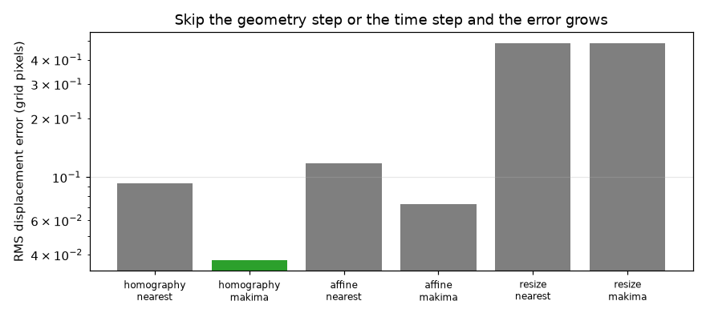
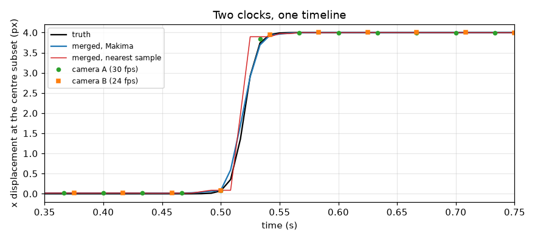
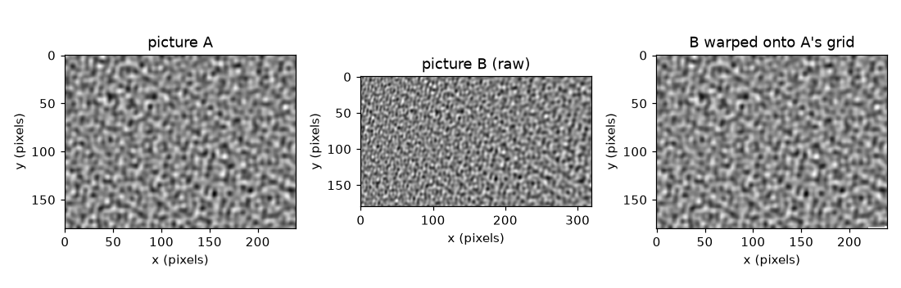

# Session 3: A mini stereo-DIC pipeline, validated against a known motion

*Level 3 (simulation and validation) · about 90 minutes · openstitchdic*

> This is a simplified educational model. It is not a validated design tool and must not be used for real structures, electrical installations, vehicles, industrial processes or medical decisions.

**Prerequisites**

- Session 2: homography, bilinear warping, Makima.
- Mean, standard deviation and RMS error.

**Learning objectives.** After this session you can:

- Build a pipeline: camera model, homography to a common grid, subset correlation, time alignment, merge.
- Measure displacement with ZNCC and a parabola, and state its error against a known truth.
- Quantify how skipping the homography or the time alignment inflates the error.
- Handle edge cases: extrapolation outside the sampled time range and occlusion at the picture border.
- Use your own pictures through the data folder.

## A. Real-world problem
A flat speckled sample moves while camera A (4:3, 30 fps, almost head-on) and camera B (16:9, 24 fps, 28 degrees to the side) film it. We simulate the cameras, so the true motion is known exactly. Can the pipeline recover it to a fraction of a pixel? Which step matters most? And what happens when part of the sample leaves one camera's picture, or when you ask for data outside the time that was filmed? (A simplified educational model on synthetic data, not a validated measurement procedure.)

## B. Concept and theory
Each camera is a homography from the sheet to its picture, built from a focal length, a viewing angle and a distance. We click the four sheet corners in each picture (with a click error of 0.3 px) and solve a homography from the clicked camera pixels to the common 160 x 120 grid, where one grid pixel is one sheet unit. Each warped frame is compared with frame 0: a (2h+1) x (2h+1) subset, h = 10, is slid over every shift within +-6 px and scored by zero-normalised cross-correlation (ZNCC), which ignores brightness and contrast changes. The best whole-pixel shift is refined by a parabola through the peak and its neighbours: delta = (c_- - c_+) / (2 (c_- - 2 c_0 + c_+)). Each camera's displacement series is resampled to the 120 fps timeline and the two are averaged. The truth is a motion amplitude s(t) with ux = s (1 + g (X - 80)), g = 0.004, and uy = 0.4 s. Error is the root-mean-square difference between merged data and truth over the nine subsets, both components and the timeline. We compare three geometries (homography, best affine fit, plain resize) and three timings (nearest sample, linear, Makima), and two correlation modes: against frame 0 (reference) or against the previous frame with the steps added up (consecutive).

| Symbol | Meaning | Unit |
|---|---|---|
| s(t) | true motion amplitude | px |
| (ux, uy) | true displacement of a subset | px |
| h | subset half size (21 x 21 pixels) | px |
| c(-1), c(0), c(+1) | ZNCC scores around the best whole-pixel shift | no unit |
| delta | sub-pixel correction from the parabola | px |
| RMS | root-mean-square error against the truth | px |
| g | gradient of the true displacement along x | 1/px |

**Assumptions**

- A flat sample and one homography per camera; no lens distortion and no rolling shutter.
- Speckle is a smooth random pattern; noise is Gaussian with a standard deviation of 2 percent of the pattern.
- The motion is a translation with a small gradient; subsets are assumed to move rigidly.
- The two clocks are in step (offset 0) in this session; Session 2 showed how to estimate an offset.

$$ \delta=\frac{c_{-}-c_{+}}{2\,(c_{-}-2c_{0}+c_{+})} $$

$$ \mathrm{ZNCC}=\frac{\sum (f-\bar f)(g-\bar g)}{\sqrt{\sum (f-\bar f)^2\,\sum (g-\bar g)^2}} $$

$$ u_x=s(t)\,\big(1+g\,(X-80)\big),\qquad u_y=0.4\,s(t) $$

$$ \mathrm{RMS}=\sqrt{\frac{1}{N}\sum\big(u_{\mathrm{merged}}-u_{\mathrm{true}}\big)^2} $$

## C. Visual explanation
The first figure shows picture A, picture B and picture B warped onto A's pixel grid; for the synthetic pair the warped B correlates with A at 0.999. The second figure is a bar chart of the merged RMS error for the six geometry-and-timing combinations on a step-like motion, on a logarithmic axis: homography with Makima is the lowest bar and plain resize the highest by a wide margin. The third figure shows the displacement of the centre subset: the 30 fps and 24 fps measurements, the truth, the Makima-merged line and the nearest-sample line, which shows staircase errors at the jump.

*Merged RMS error for six geometry and timing choices on a step-like motion (logarithmic axis).*

*The 30 fps and 24 fps measurements, the truth, and the merged line with Makima and with nearest samples.*

*Picture A, picture B and picture B warped onto A's pixel grid (your pictures if you added them to the data folder).*

## D. Interactive simulation
Run the lesson (`python start.py 3`), then open the live app: [Session 3: the parabola behind sub-pixel correlation](https://krunalpanchal1995.github.io/openstitchdic/session-03/) (or `app.html` in this folder). Run the lesson. It prints which pictures it used. To use your own pictures, create a folder named data next to start.py (in Colab, a folder named data in the working directory), put view_a.png (or .jpg) and view_b.png in it, and optionally a points.txt with four lines `xa ya xb yb` giving the same four physical points in picture A and in picture B; run `python start.py 3` again and look at pair_on_grid.png. Without points.txt, picture B is only scaled and cropped to the shape of A. In the app, change the width of the correlation peak and the true fractional shift and watch the parabola's sub-pixel bias.

**Challenge.** Find a fractional shift and a peak width for which the parabola estimate is wrong by more than 0.05 px.

## E. Worked example and experiment
**Problem.** A subset's ZNCC scores at whole-pixel shifts 2, 3 and 4 are 0.80, 0.95 and 0.90. What sub-pixel shift does the parabola give? And is the pipeline's whole recipe, camera model plus homography, consistent for the synthetic pair?

1. The best whole-pixel shift is 3 (score 0.95); its neighbours are c(-1) = 0.80 and c(+1) = 0.90.
2. delta = (0.80 - 0.90) / (2 * (0.80 - 2 * 0.95 + 0.90)) = (-0.10) / (2 * (-0.20)) = 0.25.
3. The shift is 3 + 0.25 = 3.25 px.
4. For the synthetic pair, warping picture B onto A's pixel grid with the homography solved from the four sheet corners gives a correlation with A above 0.99 (the checkpoint prints 0.999).

**Answer.** The sub-pixel shift is 3.25 px, and the warped synthetic picture B matches picture A with a correlation of 0.999.

**Experiment.** Move a printed speckle pattern by a known amount with a micrometer stage (for example 0.5 mm) and film it with your two cameras. Compare the measured displacement with the stage reading. Differences come from the cameras' lens distortion, a sample that is not flat, vibration and the real speckle (sharp dots and noise) against the smooth synthetic pattern: the model gives an optimistic error.

## Real-world application and mini-project: Align a 30 fps 4:3 camera and a 24 fps 16:9 camera, and report the error before and after
Two cameras film a speckled sample that jumps like a step. Camera A is 240 x 180 (4:3) at 30 fps, camera B is 320 x 180 (16:9) at 24 fps and looks 28 degrees to the side. Use `before_after('step')` and `run_pipeline` from Session 3 to measure the displacement error with no alignment (pictures only resized to the grid, frames paired by nearest time) and with alignment (homography and Makima). Optional: drop your own view_a.png and view_b.png (and points.txt) into a folder named data next to start.py, run Session 3, and look at the picture pair_on_grid.png it saves.

**Deliverable:** A script that prints a table of merged RMS error for geometry in (homography, affine, resize) and timing in (nearest, makima), names the best and the worst combination, and saves a bar chart of the six numbers.

**Success looks like:** Before alignment the error is 0.485 px, after it is 0.038 px (a factor of 13); homography with Makima is the best of the six combinations and a plain resize with nearest-time pairing is the worst.

## F. Assessment and design challenge
**Question type A: Conceptual.** Why does correlating each frame with the previous frame and adding up the steps give a larger error than correlating each frame with frame 0?

Hint

Each step has a small error; think about what happens when you add 23 of them.

Step-by-step solution

Every step carries a small error (the parabola bias and noise). Adding steps adds their errors, which grows with the number of frames (a random-walk drift), while correlating with frame 0 gives each frame its own independent error. In the simulation the merged RMS is 0.083 px with consecutive correlation against 0.023 px with the reference frame. The reference method needs a search window large enough for the whole motion, which is why consecutive correlation is used for large motions.

**Question type B: Numerical.** ZNCC scores 0.60, 0.90 and 0.85 at shifts 4, 5 and 6. Find the sub-pixel shift. Give the unit.

Hint

Use delta = (c(-1) - c(+1)) / (2 (c(-1) - 2 c(0) + c(+1))) around the best whole shift 5.

Step-by-step solution

delta = (0.60 - 0.85) / (2 * (0.60 - 1.80 + 0.85)) = (-0.25) / (2 * (-0.35)) = 0.357. The shift is 5.357 px. Sanity check: the right neighbour (0.85) is higher than the left one (0.60), so the true peak lies to the right of 5, and delta is between 0 and 0.5 as it must be.

**Question type C: Graph and simulation interpretation.** In the error-budget bar chart (step-like motion), read the five errors: homography with Makima, homography with nearest, affine with Makima, and resize with nearest. What does each bar tell you to fix first?

Hint

Compare each bar with the lowest one.

Step-by-step solution

Homography with Makima is the lowest at 0.038 px. Pairing frames by nearest time instead raises it to 0.093 px (2.4 times). Using an affine fit instead of the homography raises it to 0.073 px (1.9 times), almost entirely from camera B, whose perspective an affine map cannot describe. A plain resize with nearest pairing gives 0.485 px (13 times), because the two cameras then measure in different pixel units. Fix the geometry first (it has the largest effect), then the timing.

**Question type D: Design and optimisation challenge.** Design: part of the sample leaves camera B's picture, so 3 of the 9 subsets cannot be measured in B. What do you do with the missing pixels, and what do you do about times where only one camera has data? Justify with the numbers.

Hint

Compare masking the missing pixels with filling them with zeros, and check what the merge does at the end of a camera's time range.

Step-by-step solution

Mask them: a subset that touches missing pixels returns NaN and the merge uses camera A alone there. The merged RMS stays at 0.024 px, against 0.053 px if the missing pixels are filled with zeros (the black edge is static and pulls the subset towards zero displacement). For time, never extrapolate by default: continuing Makima beyond the last sample gives errors of 0.39, 2.31 and 7.04 px one, two and three frames beyond the end, against 0.009 px inside the range. Use the other camera, or stop the data where both have samples.

Score yourself with [RUBRIC.md](../../RUBRIC.md). Print the [activity sheet](activity_sheet.md) to work on paper.

## Common misconceptions
| Common misconception | What is actually true |
|---|---|
| If the correlation is good, the displacement is accurate. | ZNCC can match a pattern perfectly in a picture that was warped with the wrong geometry; the error then shows up as a scale error of the displacement. |
| An affine fit is a homography without the extra numbers, so it is just as good. | An affine fit cannot describe perspective. For camera B at 28 degrees it multiplies the error of that camera by more than 5. |
| Extrapolating a smooth curve a bit beyond the data is safe. | A cubic continued outside its last interval grows quickly; a single frame beyond already gives 0.39 px against 0.009 px inside. |
| Missing pixels can be set to zero. | Zeros create a fake static edge that biases the correlation; mask the pixels and skip the subset instead. |

## Glossary
- **subset**: a small square window of pixels that is followed from picture to picture
- **ZNCC**: zero-normalised cross-correlation: a match score from -1 to 1 that ignores brightness and contrast
- **sub-pixel**: finer than one pixel, here from a parabola through the correlation peak
- **RMS error**: square root of the mean of the squared errors
- **occlusion**: part of the sample not visible to a camera
- **extrapolation**: estimating values outside the range of the data

## Finish
1. Do the three coding tasks in [exercises.md](exercises.md).
2. Run `python start.py 3` again after your changes. It ends with the checkpoint; when it prints `PASS`, you are done. (Checkpoint only: `python start.py check 3`.)

Next: the [roadmap](../../promo/roadmap.md). Session 4 is yours to build.
